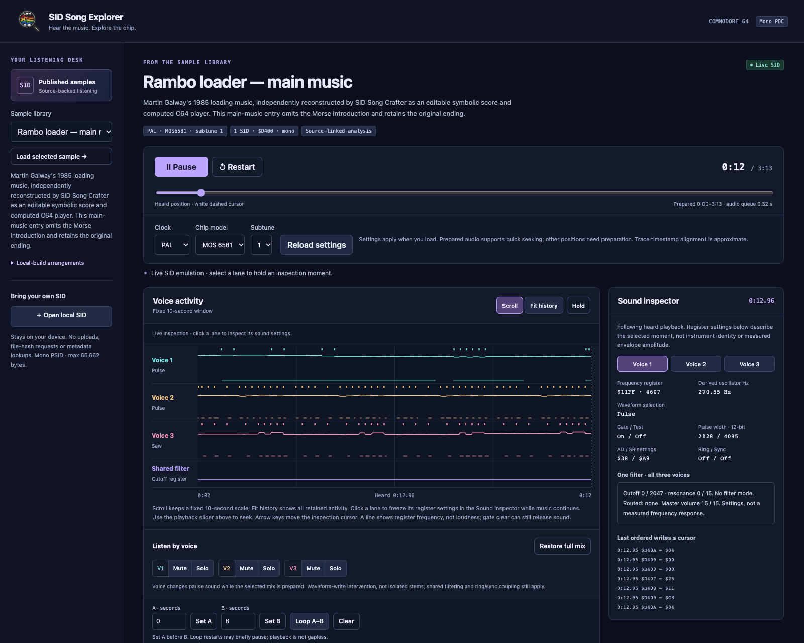

<p>
  
</p>

# SID Song Explorer

SID Song Explorer is a browser player and inspector for Commodore 64 SID music. It connects a heard passage to voice/register activity and source-backed explanations, using an existing SID emulator.

<p>
  <a href="https://mbackschat.github.io/sid-song-explorer/"></a>
  <a href="assets/screenshots/rambo-playing.png"></a>
</p>
<p><sub>Rambo loader — live mono playback. Click the screenshot to enlarge.</sub></p>

## Related projects

- [ **SID Song Crafter**](https://github.com/mbackschat/sid-song-crafter) — arrange and export the music explored here.
- [**Williams Sound Explorer and Designer**](https://github.com/mbackschat/williams-sound-explorer) — explore and design arcade sound effects.

## Current state

The first mono proof of concept is implemented, with passing engine and headless Chromium/WebKit interaction checks. It uses a small TypeScript/Vite application over `libsidplayfp-wasm` 1.1.0's SIDLite engine. Real desktop Safari playback through the complete ending and the user's judgment of the explanations remain pending; milestone 1 is not complete. [The plan](docs/PLAN.md) owns status, and [the validation record](docs/validation/mono-poc.md) separates checks from remaining listening and browser gates. The app is hosted on GitHub Pages; local files remain on your device.

## Implemented POC capabilities

- Play the four public mono samples linked in Crafter’s README: Rambo loader main music, Bach Toccata, Mozart Minuet and Trio, and the original instrument mix. Each uses pinned, hash-verified files with its matching WAV, attribution, license and source links.
- Follow stereo SID/WAV links for each published song. Live playback/inspection remains mono. Moon River, Pink Panther, Axel F and Ghostbusters appear separately as local-build materials, without unpublished audio.
- Open callable mono PSID files locally, with subtune, PAL/NTSC and MOS6581/MOS8580 controls; local files and their hashes stay on the device.
- Play, pause, restart, seek quickly within the prepared audio range, with busy feedback for unprepared positions, and set A–B study loops.
- Mute or solo the three physical SID voices, with the waveform-write intervention and shared hardware dependencies labelled. Changing voices pauses sound to prepare the mix; a spinner and explanation appear beside the controls. Uninterrupted switching is tracked as `VOICE-1` in [the post-POC plan](docs/PLAN.md#exit-the-poc-and-continue-production-work).
- Switch voice activity between **Scroll** (the default fixed ten-second window) and **Fit history** (the former expanding overview) in the graph header; select retained voice/register history while music continues, hold an inspection cursor, and return to following the heard playhead.
- Inspect frequency, waveform, gate, pulse width, ADSR settings, ring/sync, the shared filter and ordered writes, alongside PCM levels, waveform and spectrum.
- Read three evidence-linked Rambo annotations with their exact evidence and listening scope.

The POC accepts a bounded callable mono PSID subset; RSID, ROM/interrupt-driven profiles and additional SID chips are outside it. Seeking and loop continuation require the validation described in [the playback adapter](docs/architecture/playback-adapter.md); a state-restored loop does not promise a seamless audio splice. Dual-SID routing, the full model/count matrix and recent-iPhone compatibility remain product requirements for later gates in [the founding design](docs/design/web-player-and-analyser.md).

## Published library

The [live app](https://mbackschat.github.io/sid-song-explorer/) mirrors [Crafter’s downloadable samples](https://github.com/mbackschat/sid-song-crafter#downloads). Rambo remains the initial selection and carries three source-linked annotations; the other songs use generic live register inspection. Stereo files open separately for use in a compatible player. The [pinned catalog](config/catalog.json) records the precise files and provenance; [source preparation](docs/integration/poc-sources.md) explains updates.

The [Application workflow](.github/workflows/app.yml) deploys `main` only after both supported browser/platform jobs pass. It builds and uploads the cleared assets, license notices and corresponding engine source. [Publication checks](docs/validation/mono-poc.md#github-pages-and-readme-catalog) cover the hosted app separately from local tests.

## Set up and validate

Use Node.js 24.18.0 (package minimum 24.12) and pnpm 11.20.0. Package versions are pinned in [package.json](package.json) and [the lockfile](pnpm-lock.yaml).

```sh
git clone https://github.com/mbackschat/sid-song-explorer.git
cd sid-song-explorer
pnpm install --frozen-lockfile
pnpm prepare:assets
pnpm dev
```

Open the local URL printed by Vite, normally `http://127.0.0.1:5173`. Asset preparation downloads the cleared sample files and copies the engine license, notices, modifications and complete corresponding source into ignored `public/generated/`. The build includes those files in `dist/`; prepare them before building or serving the app. No sibling checkout, private cache, ROM download or live emulator bridge is required. [The sample snapshot guide](docs/integration/poc-sources.md) records exact hashes, rights, download limits and the optional explicit local-copy command.

```sh
pnpm test
pnpm build
pnpm exec playwright install chrome
# On macOS, also install the WebKit test browser:
pnpm exec playwright install webkit
pnpm test:browser
```

Browser checks use Google Chrome on Linux and macOS, plus Playwright WebKit on macOS only. CI runs Chrome on Ubuntu and WebKit on macOS; Linux WebKit is outside the supported test matrix. macOS WebKit automation does not establish playback in Apple's Safari application. For documentation checks, use Python 3.10 or newer to run `python3 scripts/check-docs.py`, then `git diff --check`. The checker validates local Markdown links and heading fragments, excluding external availability. Logo regeneration is optional; see [branding](assets/branding/README.md).

## Explore the Rambo main entry

1. Leave **Rambo loader — main music** selected and press **Load sample**, then **Play**. This runs the SID live; the retained WAV has separate controls.
2. Click a voice lane to hold an earlier moment while playback continues. Select a voice in **Sound inspector** to inspect its register state and the last ordered writes at or before the cursor. The highlighted held state names the selected voice and time; **View inspector** brings its settings into view on small screens. Press **Resume live** to follow playback again. Chart selection does not seek the audio; use the playback slider above.
3. Try **Solo** on a voice, then **Restore full mix**. The control changes SID waveform writes; shared filtering and oscillator coupling can affect the result.
4. Set A and B around a passage and enable **Loop A–B**. Use the linked evidence cards to inspect the main entrance, score returns and continuing sound lifetimes.
5. Play the retained WAV separately for context and read its scope beside the controls. The accepted underlying phrase and ending do not establish acceptance of the new cold-start entrance or of this browser performance.

**Open local SID** provides the same generic inspection without authored annotations. It does not upload the file, send a file hash or request external metadata. Unsupported profiles fail with a message; unknown durations stay labelled unknown.

## Relationship to SID Song Crafter

[SID Song Crafter](https://github.com/mbackschat/sid-song-crafter) owns composition tools, instrument programs, musical studies, sample generation and publication clearance. Explorer owns browser playback and presentation of matching evidence.

Both repositories can be worked on together in one agent session, with coordinated changes and separate commits. Explorer remains independently cloneable and buildable. This POC consumes an interim pinned [catalog snapshot](config/catalog.json) with a strict versioned parser; it does not implement the future Crafter-owned normalized catalog producer. [The shared-knowledge guide](docs/integration/crafter-handoff.md) defines ownership and coordinated development, and [the POC source record](docs/integration/poc-sources.md) defines this bounded import.

## Documentation

- [Plan](docs/PLAN.md): current scope and next development task.
- [Playback adapter](docs/architecture/playback-adapter.md): app-base choice, engine boundary and timing limits.
- [Mono POC validation](docs/validation/mono-poc.md): technical evidence and outstanding Safari/listening gates.
- [Sample snapshot](docs/integration/poc-sources.md): pinned assets, rights and annotation scope.
- [Founding design](docs/design/web-player-and-analyser.md): product contracts and verification gates.
- [Application research](docs/research/web-music-explorers.md): dated comparisons and reuse alternatives.
- [Contributor guide](CLAUDE.md): development conventions and validation.
- [Screenshot harness](docs/validation/screenshots.md): reproduce and refresh the live Rambo README image.
- [Branding](assets/branding/README.md): selected logo, exports and reproduction.
- [Documentation index](docs/README.md): navigation.

## License

Copyright (c) 2026 Martin Backschat. Original Explorer work is licensed under **GPL-3.0-or-later**: you may redistribute and modify it under version 3 of the GNU General Public License or any later version, without warranty. See [LICENSE](LICENSE).

Transferred Crafter documents and reused logo geometry retain their MIT notice. The engine is GPL-2.0-or-later and the published Rambo sample is GPL-3.0-only; their notices and corresponding-source routes remain separate. See [third-party notices](THIRD_PARTY_NOTICES.md).
